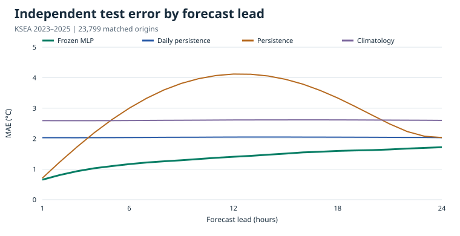
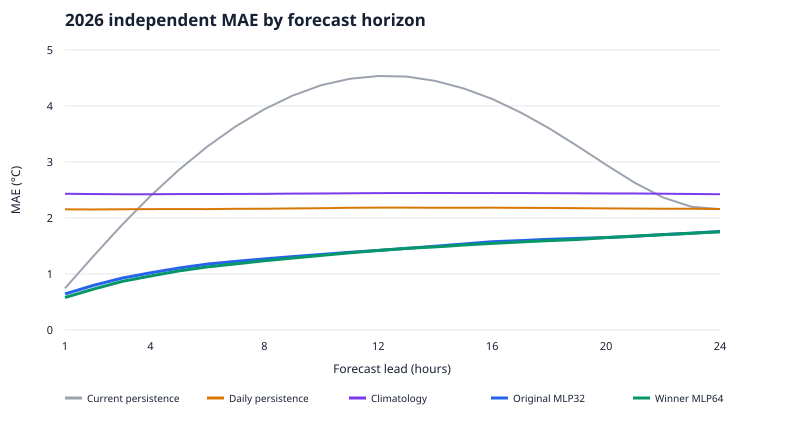

# Aevral

An open research laboratory for forecasting: identifying useful observations, learning temporal relationships, and measuring predictive skill across domains.

The first campaign studies neural networks for hourly air-temperature forecasting at Seattle–Tacoma International Airport (KSEA). Aevral is not restricted to neural networks or weather.

## First research milestone completed

**1.363°C MAE on the independent 2023–2025 KSEA test**, 33.34% lower than daily persistence, across 23,799 matched origins. See the [campaign report](campaigns/001-neural-weather/REPORT.md), [all experiments](results/README.md), and [independent evaluation](results/AEV-009/README.md).



## Second research milestone completed

**1.353°C MAE on the independent January–October 2026 holdout**, 1.83% lower than the original MLP and 37.67% lower than daily persistence, over 6,521 matched origins. Eleven initial architecture configurations and a 36-run multi-seed optimization comparison. [Campaign report](campaigns/002-architecture/REPORT.md) · [Independent results](results/AEV-015/README.md).



## Completed fixed-data research program

[C003–C015: comprehensive fixed-data temperature forecasting](campaigns/TEMPERATURE-PROGRAM.md). Same KSEA archive, broad model families, controlled rolling-origin development folds, bounded optimization and final retrospective ranking. C003–C015 complete. **P13 residual-tree ensemble: 1.29559°C retrospective pooled MAE**, 2.50% below the incumbent on 30,275 matched origins (726,600 targets). All 96 final evaluations measured and independently audited. [Final report](campaigns/015-tournament/REPORT.md) · [Numerical archive](results/C015/final/) · [Rankings](results/C015/final/ranking.csv). The assessment periods were previously exposed; this is not independent prospective confirmation.

## Research principles

- Define the forecast origin, target, horizon and information available at issue time.
- Compare every model to transparent baselines on the same cases.
- Freeze chronological train/validation/test splits; never tune on the test set.
- Publish failed experiments alongside successful ones.
- Cache raw data locally, record provenance and checksums, and keep large artifacts out of Git.
- Separate real historical backtests, prospective forecasts, and synthetic implementation checks.

## Start here

- [Ontology](ONTOLOGY.md)
- [Research roadmap](ROADMAP.md)
- [Campaign 001](campaigns/001-neural-weather/README.md)
- [Experiment 001](experiments/AEV-001.md)
- [Dataset manifest](domains/weather/ksea.md)
- [Continuation state](STATE.md)

## Development

Rust is the primary language. The educational neural-network core is dependency-free; Burn and GPU backends are later comparisons. A verified, locked Nix development shell is provided.

```sh
nix develop
cargo test
cargo run --release -- smoke
```

The smoke command learns synthetic data only; it is not a weather result. Real-data experiments and reproducibility instructions are in the campaign report.
