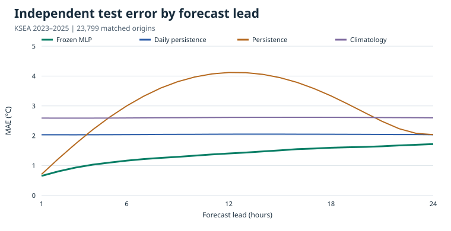

# C001 initial milestone — Neural weather forecasting

**Completed 2026-11-26.** A dependency-free Rust MLP learned to forecast the next 24 hours of KSEA air temperature using local historical observations and origin-time covariates. No future observations are inputs. Forecast targets are last routine reports in hourly UTC bins, not exact instantaneous observations.

## Experimental progression

| Experiment | Matched comparison | Selected result (MAE °C) |
|---|---|---:|
| [AEV-001](../../results/AEV-001/README.md) | 24h temperature vs baselines | 1.64647975 |
| [AEV-002](../../results/AEV-002/README.md) | 6–72h history | 1.59702117 (72h) |
| [AEV-003/004](../../results/AEV-003-004/README.md) | Calendar inputs | 1.54146757 (both cycles) |
| [AEV-005–008](../../results/AEV-005-008/README.md) | Eight weather feature subsets | 1.39610378 (all) |
| [AEV-009](../../results/AEV-009/README.md) | Independent 2023–2025 test | 1.36319041 |

Cohorts differ between stages; cross-stage error differences are not pure feature effects. Within each stage, all candidates share eligible cases. Longer history helped substantially through 48h; 72h was a near tie. Both calendar cycles helped. Wind was the strongest individual additional weather group; all three groups combined performed best.

## Final architecture and evidence

80 inputs: 72 temperature values, 4 cyclic calendar values, dew point, altimeter pressure, two wind vector components. One 32-unit tanh hidden layer, 24 linear outputs, 3384 trainable parameters. Ten epochs, learning rate 0.005, seed 42, train-only normalization. Training 2000–2018; validation 2019–2022; independent test 2023–2025. 23,799 joint eligible independent origins, 33.34% MAE reduction vs daily persistence. All 26 annual raw hashes, full metrics and [test plots](../../results/AEV-009/README.md) published.

## Reproduction

Use the locked Nix shell or Rust toolchain. `bash scripts/fetch-ksea.sh 2000 2025` reuses verified existing cache files; set AEVRAL_DATA_DIR if needed. Verify hashes from the raw directory with `sha256sum -c /absolute/path/to/repo/results/AEV-009/snapshot.sha256`. From repository root run `cargo run --locked --release -- locked-test 2000 2025 data/raw/ksea` (or pass your cache path). Reproduction is not a fresh independent test. Raw redistribution rights review remains outstanding; no raw observations redistributed. Nix locked shell [verified](https://github.com/sguzman/aevral/actions/runs/45865004660); final test [CI](https://github.com/sguzman/aevral/actions/runs/45866478620).

## Acceptance and limitations

- [x] Reproducible raw data identity and coverage audit.
- [x] Passing model/data tests (19 tests on final evaluation).
- [x] Matched baseline and neural validation measurements.
- [x] Frozen independent test and public metrics.
- [x] Public report, plots and explicit limitations.

Retrospective archive latency, complete-window selection, correlated examples, fixed single seed and one station limit generalization claims. Two test report conflicts were quarantined before scoring; the first run failed and remains documented. No operational service, serialized model, GPU model, prospective forecasts or recurrent architecture delivered in this initial milestone. Future campaigns require a newly designated evaluation set rather than tuning on the exposed test. Initial approved milestone complete; later roadmap work not automatically started.
