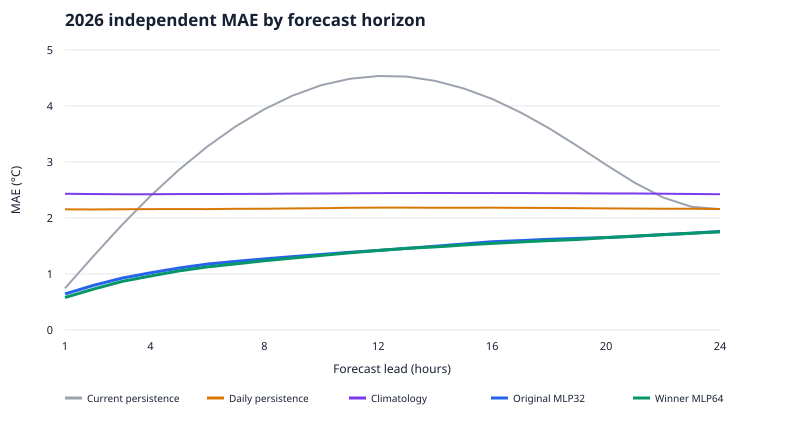

# C002 — Architecture comparison: completed research report

## Result
The frozen 80→64→24 MLP, trained for 30 epochs with SGD .005, achieved 1.35264044°C MAE on the independent January–October 2026 KSEA holdout, versus 1.37790156°C for the original 80→32→24 MLP trained for 10 epochs. Improvement 1.833304% relative to the original and 37.674004% relative to daily persistence. This is a modest incremental improvement, not a solved forecasting problem.

| Forecast | MAE (°C) | RMSE (°C) | MAE reduction vs daily |
|---|---:|---:|---:|
| Winner MLP64 | 1.352640 | 1.796293 | 37.67% |
| Original MLP32 | 1.377902 | 1.825811 | 36.51% |
| Daily persistence | 2.170267 | 2.843450 | 0.00% |
| Climatology | 2.435842 | 3.168644 | -12.24% |
| Current persistence | 3.255039 | 4.331375 | -49.98% |

## Controlled experiments
Same 80 inputs (72 hourly temperatures, four calendar features, dew point, altimeter pressure, two wind components); 24 hourly direct outputs. Same 121,849 train and 30,207 validation origins, train-only scales, historical frozen hashes.

- [AEV-010](../../results/AEV-010/README.md): linear and dense widths/depths. MLP64 1.38652827 vs original 1.39610378 at 10 epochs seed42.
- [AEV-011](../../results/AEV-011/README.md): recurrent, GRU, LSTM; all weaker in their screened forms.
- [AEV-012](../../results/AEV-012/README.md): CNN and dilated TCN, both weaker in their screened forms.
- [AEV-013](../../results/AEV-013/README.md): compact self-attention, 1.55932750°C at 10 epochs.
- [AEV-014A](../../results/AEV-014A/README.md), [AEV-014B](../../results/AEV-014B/README.md): 36 jobs and 72 checkpoints, six architectures, three seeds, two optimizers, 10/30 epochs. MLP64 SGD 30 epochs ranked first by three-seed mean validation MAE 1.35698070°C (sample SD .00939120°C). Seed42 fixed before acquisition, not selected for lowest seed-specific score. Adam .001 underperformed SGD .005 across matched means; optimizer-family optimality is not established.
- [AEV-015](../../results/AEV-015/README.md): winner frozen at 4b36e62c740d92f42272ba52cf1e4ea0101abd02 before acquisition. 27 verified hashes; 6,521 matched origins, 89.66% coverage, 30 passing tests; original and winner validation reproduction before scoring. Winner lower MAE in 8 of ten months. Full aggregate, lead, monthly, training and illustrative forecast records archived.

## Interpretation and limitations
The comparison favors a wider dense model on this particular input representation, station, data window and tested budgets. Capacity and training duration both differ between the original and winning final models, so independent improvement cannot be attributed to width alone. Temporal models were compact variants with constrained representations; larger or better-tuned designs could win. Seeds measure optimization variation, not independent weather realizations. Overlapping origins, missing-case selection, one station, historical archive timing and lack of prospective forecasting limit generalization. No numerical-weather-prediction comparison. No statistical significance or universal superiority claim. The 2023–2025 and 2026 test sets are now exposed. Future campaigns must predeclare a new evaluation design; no test-driven tuning in C002.

## Reproduction
Use the existing Nix development shell and locked Rust dependencies. Restore the frozen KSEA CI cache or obtain byte-identical raw files, verify all 27 hashes with results/AEV-015/snapshot.sha256, then run `cargo run --locked --release -- holdout-score 2000 2026 data/raw/ksea`. See [workflow](../../.github/workflows/holdout-score.yml). CI [snapshot](https://github.com/sguzman/aevral/actions/runs/45880006747), [audit](https://github.com/sguzman/aevral/actions/runs/45880124408), [scoring](https://github.com/sguzman/aevral/actions/runs/45880217793). No raw data redistribution.

C002 acceptance criteria fulfilled. Further model or feature exploration requires a newly approved campaign.
