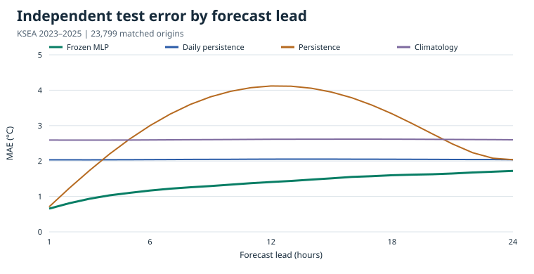
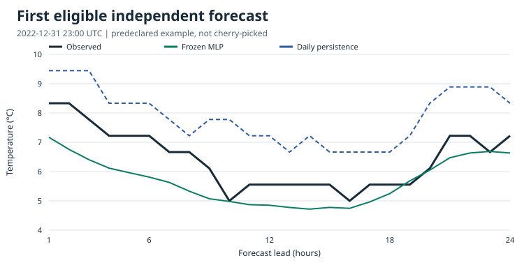

# AEV-009 — Independent test of the frozen model

**Completed.** [Successful CI](https://github.com/sguzman/aevral/actions/runs/45866478620), code 22cbf2491530e90f54582b4c68e11a1c20f8742d. First attempt [failed during parsing](https://github.com/sguzman/aevral/actions/runs/45866322966), before training/scoring. All 26 frozen raw checksums matched on retry; see snapshot.sha256. The original 121849 training cases and fitted normalization reproduced; 19 unit tests passed. No validation or test examples were used to fit the model.

| Model | MAE (°C) | RMSE (°C) |
|---|---:|---:|
| Persistence | 2.99508927 | 4.05978069 |
| Daily persistence | 2.04501454 | 2.66899822 |
| Climatology | 2.60599238 | 3.38703165 |
| Frozen MLP | 1.36319041 | 1.82260032 |

Skill vs daily persistence: 33.340796% MAE reduction. Lead-one MAE: 0.65590002; lead-24 MAE: 1.72109922. 

| First target year | Origins | MLP MAE | Daily MAE |
|---|---:|---:|---:|
| 2023 | 8049 | 1.42811165 | 2.10755362 |
| 2024 | 7752 | 1.31958132 | 2.02223202 |
| 2025 | 7998 | 1.34012297 | 2.00415845 |

Coverage: 26281 possible origins, 24599 temperature-complete, 23799 joint-complete (90.56% of possible); 571176 hourly target predictions. Two conflicting timestamps quarantined (UTC minutes 13087380 and 13508970 since 2000-01-01). The quarantine rule was introduced after acquisition but before any test scores, documented in the protocol; no arbitrary duplicate selection. All models use identical eligible cases. See metrics.txt for 150 logged records.

The first eligible example originates at 2022-12-31 23:00 UTC. It is illustrative, not a summary of performance. The 2023–2025 dataset is now exposed and cannot be considered unseen for future model selection. Results are retrospective, not operational; archived observation publication latency is unknown. Complete-case filtering, single station, one seed, correlated overlapping origins and unequal parameter counts limit inference. No confidence intervals or causal effects claimed; no comparison with numerical weather prediction. No further tuning on this test set.
